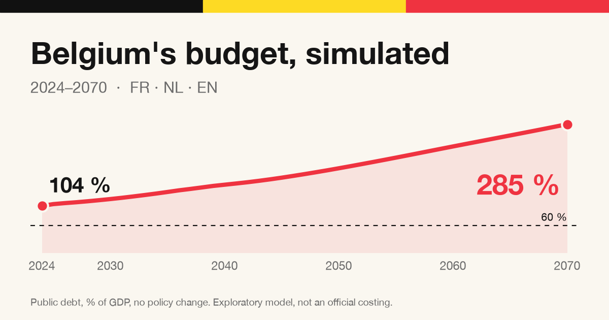

# belsim

A small simulator of Belgium's public finances. Change a tax rate, a pension age or a spending
rule, and see what happens to the deficit, the debt and employment from now to 2070.

It is a toy to play with and argue over, not an official costing.



## Try it

```
uv sync
uv run python -m belsim.api
```

Then open http://127.0.0.1:8000. You need [uv](https://docs.astral.sh/uv/) and nothing else.

## What you can do

- Follow every revenue and spending line of the Belgian state, year by year.
- Change any of about 470 parameters (rates, ages, ceilings, growth norms) and compare with
  "no policy change".
- Look at Flanders, Wallonia and Brussels separately.
- Load the 2024 programme of each of 12 parties, as costed by the Federal Planning Bureau,
  and compare them.
- See who gains and who loses by income level, and what happens to a payslip.
- Read it in English, French or Dutch.

## How much to trust it

Not too much. The starting point is real: the 2024 and 2025 public accounts, official
statistics and current law. The baseline follows official projections. Beyond that, it is a
simplified model with many assumptions (they are flagged in the app), built in a few days by
one person directing AI coding agents, and nobody independent has reviewed it yet.

When compared with official costings, roughly two results in five land within 10% and two in
three within 25%. The app has a Validation page that shows every comparison, and a
Methodology page that explains the choices made.

Found something wrong? [Open an issue](https://github.com/daliscia/belsim/issues).

## More

- [docs/DETAILS.md](docs/DETAILS.md): what the model covers, what matches official figures and
  what does not.
- [docs/ARCHITECTURE.md](docs/ARCHITECTURE.md): how the code is organised.
- [docs/DEPLOY.md](docs/DEPLOY.md): hosting it publicly.
- `uv run pytest -q` runs the tests.

## Licence

Free software, [AGPL-3.0-or-later](LICENSE). Data from Eurostat, the National Bank of Belgium,
Statbel and the Federal Planning Bureau keep their own terms; see [NOTICE.md](NOTICE.md).
